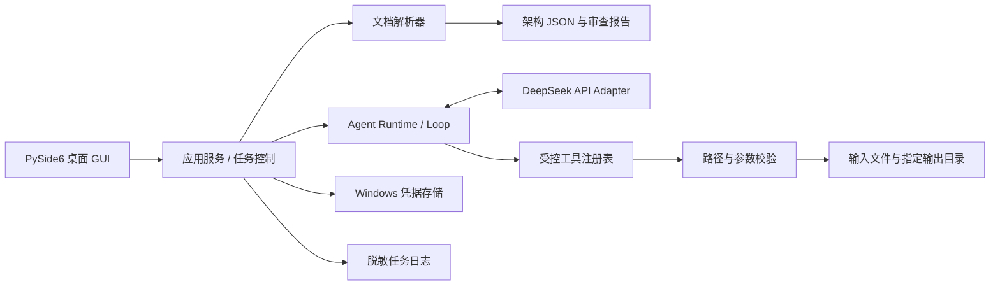

# Code Agent 开发指导书

> 版本：1.0
>
> 状态：开发指导与验收基线
> 目标：实现一个调用 DeepSeek 官方 API 的简易代码智能体，提供 Windows 桌面 GUI，接收架构 Markdown 文档并在指定输出目录生成项目代码及配套资料。

## 1. 文档目的

本文档将需求转化为可执行的开发顺序、组件边界、测试策略、发布步骤和验收标准。团队应按阶段推进，每一阶段都产出可检查的结果，并在进入下一阶段前满足退出条件。

本文件是计划和约定，不代表项目代码、API 联调、测试或 EXE 打包已经完成。

## 2. 项目目标与范围

### 2.1 产品目标

桌面程序应允许用户：

1. 配置并验证 DeepSeek API Key。
2. 选择架构文档 `Architecture_Documentation.md`。
3. 选择架构视图 `Architecture_View.md`。
4. 指定生成项目的输出目录。
5. 启动、观察和取消 Agent 任务。
6. 查看生成结果、日志摘要和未解决的架构问题。

Agent 应把文档转换成可校验的结构化规格，再基于规格规划并生成项目文件。输出至少包括项目代码、适用的依赖声明文件、README 和配套测试用例。Dockerfile 可在架构要求明确时生成。

### 2.2 第一版范围

- Windows 桌面 GUI。
- 模型固定为 DeepSeek 官方 API 的 `deepseek-v4-pro`；不下载或运行本地模型权重。
- 首批输入为 Markdown；架构图中出现 PlantUML 时，提取并保留对应代码块。
- 工具调用限定为受控的文件读取、目录查看、文件创建、文件编辑和任务结束。
- 生成文件只能写入用户指定的输出目录。
- 生成并保存结构化架构规格和架构审查报告。
- 正常自动化测试使用 Mock API；真实 API 测试单独运行。

### 2.3 第一版暂不包含

- 任意 Shell/PowerShell 命令执行。
- 多 Agent、MCP、插件市场、长期记忆和向量检索。
- 对所有 UML 方言进行完整语义解析。
- 自动部署到云服务或自动创建数据库、云资源。
- 未经用户确认执行生成项目中的任意脚本。

这些能力可以在核心流程稳定后逐项评估。

## 3. 当前输入样例与质量要求

当前工作区包含 `Architecture_Documentation.md` 与 `Architecture_View.md`。前者的说明称有 11 个 PlantUML 图，但后者实际有 13 个独立 PlantUML 代码块。第一轮开发应把数量差异作为审查报告中的冲突，并把这两份文件作为固定样例和回归测试夹具。

样例中存在需要报告而非自行猜测的问题：

- 需求追踪表只列出部分 ID，但正文还引用了 `ASR-2`。
- `Admin` 出现在架构视图和组件图中，但高层组件概览没有相应组件。
- 交付清单中的 `sql/question_ddl.sql` 与后文 `sql/game_ddl.sql` 不一致。
- API 和数据模型示例较简略，部分部署和技术栈选择缺少充分依据。

因此预处理结果应同时包含已提取事实、来源位置、冲突/缺失项和待确认问题。Agent 不应把缺少的信息伪装成原文事实。

## 4. 参考资料与采用原则

- [Anthropic Claude Code 仓库](https://github.com/anthropics/claude-code)：参考官方工具的工作流和外围集成组织方式。
- [How Claude Code Works](https://github.com/Windy3f3f3f3f/how-claude-code-works)：参考其对上下文组装、Agent Loop 和工具执行的教育性分析；该项目声明其内容不是 Anthropic 官方实现说明。
- [Claw Code](https://github.com/ultraworkers/claw-code)：参考 API、Runtime、工具、会话和权限等模块边界。
- [DeepSeek Responses API](https://api-docs.deepseek.com/api/create-response/) 与 [Responses API 指南](https://api-docs.deepseek.com/guides/responses_api/)：作为模型调用和 function tool 协议的官方依据。
- [Qt for Python 部署指南](https://doc.qt.io/qtforpython-6/deployment/deployment-pyside6-deploy.html)：作为 PySide6 Windows 打包依据。

参考项目用于学习设计模式和边界。复制任何代码前须核对其许可证、归属和分发条件。

## 5. 总体架构



依赖方向：GUI 调用应用服务；应用服务编排解析器、Agent Runtime 和文件工具；Agent Runtime 通过 Provider 接口调用 DeepSeek；工具不能绕过路径检查直接访问任意文件。

### 5.1 模型交互约定

DeepSeek Responses API 当前支持 `deepseek-v4-pro` 和 function tools。该 API 为无状态交互，多轮请求需要客户端保留并发送对话历史。每次 function call 的名称和参数都必须在本地校验，不能把模型生成的参数直接传给文件系统。

首版可以不实现 token 级流式显示，GUI 先展示任务阶段和工具执行状态，降低流式事件解析复杂度。待核心循环稳定后，再评估逐字流式输出。

### 5.2 技术选型

| 部分 | 首选方案 | 说明 |
|---|---|---|
| 桌面 GUI 与应用逻辑 | Python + PySide6 | 快速实现桌面交互；GUI 与 Agent Runtime 分层 |
| HTTP/API | DeepSeek 官方 Responses API；用小型 Adapter 隔离 SDK 或 HTTP 客户端 | 先做 API Spike，确认请求、响应和工具往返格式 |
| JSON Schema | `jsonschema` 或 Pydantic | 校验架构规格和工具参数 |
| Markdown | Python Markdown 解析库，必要时配合轻量扫描器 | 保留章节、表格和代码块来源 |
| 测试 | `pytest`、Mock Provider、临时目录 | 常规测试不依赖真实 API Key |
| Windows 打包 | PyInstaller onefile | 固定验证过的 PySide6 Essentials 版本；从隔离依赖目录构建，启动 EXE 后再验收 Qt DLL 和插件加载 |

具体依赖版本在实现阶段锁定到 `requirements.txt` 或锁文件。生成项目依赖由输入架构决定，例如样例架构提到 Node/Express 时，生成项目应有对应 `package.json`，不能把 Agent 自身的 Python 依赖误当成生成项目依赖。

## 6. 数据契约

### 6.1 `architecture.json` 建议字段

```json
{
  "schema_version": "1.0",
  "source_documents": [],
  "requirements": [],
  "components": [],
  "relationships": [],
  "interfaces": [],
  "data_entities": [],
  "deployment": [],
  "diagrams": [],
  "traceability": [],
  "conflicts": [],
  "open_questions": []
}
```

每个提取项尽量携带 `source_file`、`section`、`line_start`、`line_end` 和 `confidence`。`confidence` 用于提醒用户复核，不能代替来源证据。

### 6.2 Agent 工具契约

首版工具建议：

| 工具 | 用途 | 限制 |
|---|---|---|
| `read_input_file` | 读取已选架构文件或生成过程中的指定规格文件 | 只能读取用户选择的输入和 Agent 工作区文件 |
| `list_output_files` | 查看生成目录现有内容 | 只列出指定输出根目录 |
| `write_file` | 创建或完整重写文件 | 路径必须在输出根目录内；写入采用临时文件后原子替换 |
| `edit_file` | 修改已生成文件 | 明确目标路径和修改内容；不允许路径逃逸 |
| `finish_task` | 返回任务摘要、文件清单和未解决项 | 结束当前任务，不再发起工具调用 |

工具调用使用严格参数 schema；未知工具、缺少参数、参数类型错误和路径越界均返回结构化错误，供模型修正或向用户报告。

## 7. 端到端用户流程

1. 用户启动 exe，进入主窗口。
2. 输入或从 Windows 凭据存储读取 API Key，点击“测试连接”。
3. 选择架构文档、架构视图和输出目录。
4. 程序校验文件存在、扩展名、编码、大小限制和输出目录权限。
5. 文档解析器提取 Markdown 结构和 PlantUML 代码块。
6. Agent 生成 `architecture.json` 和 `architecture_review.md`，报告冲突与开放问题。
7. 用户确认继续生成；若目标目录已有同名文件，先询问覆盖或选择新目录。
8. Agent 按文件清单逐步创建项目文件，并更新进度和日志摘要。
9. 程序执行本地静态检查：JSON 可解析、必需文件存在、路径未越界、未写入密钥。
10. GUI 展示完成/失败状态、输出目录、文件清单、未解决问题和 API 用量（若响应提供）。

文档内容视为不可信数据。文档可以包含面向模型的指令，但这些指令不能改变本地权限策略、扩大文件访问范围或触发命令执行。

## 8. 建议的项目目录

```text
code-agent/
├── src/
│   ├── main.py
│   ├── ui/
│   ├── application/
│   ├── agent/
│   ├── llm/
│   ├── documents/
│   ├── tools/
│   ├── security/
│   ├── storage/
│   └── logging/
├── tests/
│   ├── unit/
│   ├── contract/
│   ├── integration/
│   └── fixtures/
├── packaging/
├── requirements.txt
├── README.md
└── build.ps1
```

`packaging/` 保存部署配置、图标和版本元数据。每个模块保留窄接口，避免 GUI 直接操作 HTTP 或文件系统。

## 9. 分阶段开发计划

| 阶段 | 工作内容 | 阶段产物 | 退出条件 |
|---|---|---|---|
| P0 需求基线 | 固化范围、成功标准、首版不做项；记录架构样例中的矛盾 | 本指导书、验收清单、风险清单 | 关键输入、输出和权限边界明确 |
| P1 技术 Spike | DeepSeek API 冒烟；最小 PySide6 窗口；Windows 打包试验 | API Spike 代码、测试窗口 exe、决策记录 | API 可完成一次 function call 往返；exe 可在无 Python 环境启动 |
| P2 数据契约 | 定义 JSON Schema、工具 schema、错误格式、任务状态 | `architecture.schema.json`、工具契约文档 | 有效/无效样例均得到确定的校验结果 |
| P3 文档处理 | 解析 Markdown 标题、表格、列表、fenced PlantUML；追踪来源和冲突 | Parser、固定样例输出、审查报告模板 | 现有两份文件可以重复解析，结果稳定且不丢失原文图块 |
| P4 Agent Core | Mock Provider、对话历史、工具循环、轮数上限、取消与异常路径 | 可独立运行的 Agent Runtime | Mock 用例覆盖继续、完成、失败、取消和非法工具调用 |
| P5 安全文件工具 | 根目录约束、规范化路径、符号链接检查、原子写入、文件覆盖策略 | Tool Registry、Path Guard | 越界、`..`、绝对路径、符号链接逃逸均被阻止 |
| P6 API 接入 | 接入真实 DeepSeek Adapter；认证、超时、限速和错误映射 | Provider Adapter、脱敏日志 | API Key 不入日志；function call 参数通过本地校验；失败可恢复或明确终止 |
| P7 GUI 集成 | 主窗口、后台任务线程、进度、取消、文件对话框、设置页 | 可操作桌面版 | GUI 不冻结；状态和错误均可理解；任务能完成或取消 |
| P8 质量与打包 | 单元/接口/集成/E2E 测试；standalone 和 onefile 构建；干净 Windows 验收 | 发布 exe、源码、测试报告、README | 通过第 12 节全部发布验收项 |

开发顺序采用“先验证风险，再做端到端垂直切片，再扩展细节”。P1 通过前不投入大量时间打磨界面；P2 至 P5 使用 Mock Provider，避免调试核心逻辑时依赖 API 或消耗额度。

## 10. 测试策略

### 10.1 单元测试

- Markdown 编码：UTF-8、UTF-8 BOM、CRLF、中文路径和空文件。
- 提取器：标题层级、Markdown 表格、列表、多个 fenced code block、11 个 PlantUML 块名称和内容保留。
- 架构规则：需求追踪缺项、组件引用缺失、交付文件名冲突、接口/数据模型为空时生成问题报告。
- JSON Schema：有效规格通过；缺字段、错误类型、未知枚举失败并指出字段。
- 工具参数：无效 JSON、未知工具、缺少参数、额外参数及超长路径。
- 路径安全：`..`、盘符绝对路径、UNC 路径、大小写差异、junction/symlink 逃逸。
- API 错误映射：401、429、5xx、超时、响应缺字段、无效工具参数。
- 脱敏：API Key 不得出现在 UI 日志、文件日志和异常堆栈摘要中。

### 10.2 合约测试

- 用固定请求/响应 fixture 校验 DeepSeek Provider 的序列化和反序列化。
- 验证 function tool schema 和 `call_id`/工具结果关联。
- 验证每轮请求确实包含此前的用户输入、助手输出和工具结果。
- 真实 API 冒烟测试通过显式环境变量或用户配置开启；默认测试不得要求真实 Key。
- 对 API schema 或模型 ID 的变化，要求更新 Provider 适配和对应契约 fixture。

### 10.3 集成测试

- Markdown → `architecture.json` → 审查报告。
- Mock 模型发起 `write_file` → 工具执行 → 结果回填 → 模型完成任务。
- 模型提出路径越界写入，工具拒绝，输出目录外没有变更。
- 覆盖文件冲突时 GUI 请求用户选择；取消后原文件完整保留。
- API 超时或用户取消后，Agent 不再启动新的工具调用。
- 任务结束后文件清单与磁盘上实际文件一致。

### 10.4 GUI 端到端测试

在模拟 API 环境完成完整操作：启动 → 配置 Key → 选择两份 Markdown → 选择输出目录 → 运行 → 查看完成摘要。另覆盖无 Key、无效 Key、无网络、错误输入、无写权限、任务取消和重复运行。

### 10.5 打包验收测试

- 在干净 Windows 虚拟机或等效干净环境中启动，确认无需安装 Python、Node 或 Qt。
- 从非项目当前目录启动 exe，确认资源路径正确。
- 路径含中文、空格和非 ASCII 字符时可读取和写入。
- 重启应用后验证 Key 的存储策略；若使用凭据库，确认其他 Windows 用户不能直接读取。
- 关闭网络时程序不崩溃，并给出明确错误。
- 检查最终包不包含 `.env`、测试 Key、开发机绝对路径和敏感日志。

## 11. 安全、隐私与可靠性要求

1. **API Key**：优先 Windows Credential Manager；实现首版期间若尚未完成凭据库，只允许本次进程内存使用，不写明文配置文件。日志、崩溃报告和生成文件中都不得出现 Key。
2. **数据出站**：在首次执行任务前提示用户，所选架构文档内容会发送到 DeepSeek 官方 API；仅发送完成任务所需内容。
3. **文件范围**：使用规范化绝对路径检查输出根目录；拒绝 `..`、盘符切换、UNC 逃逸和符号链接越界。所有写操作经过同一工具层。
4. **危险命令**：第一版不提供通用 Shell 工具。未来若要执行构建/测试命令，单独设计用户确认、命令白名单、超时、工作目录隔离和输出限制。
5. **上下文与费用**：设置最大 Agent 轮数、请求大小和总执行时间；记录 API 返回的用量元数据，但不记录完整敏感上下文。
6. **网络错误**：对可重试的网络错误采用有限重试和退避；认证失败、参数错误不做无限重试。
7. **部分写入**：写文件先写临时文件，再原子替换；取消任务时保留已完成文件并在摘要中说明，不伪报完整成功。

## 12. 生成项目质量策略

生成目标项目和 Agent 程序本身是两个不同的软件交付物：

- **Agent 程序**：Python/PySide6，运行在用户的 Windows 桌面。
- **生成目标项目**：由架构文档决定技术栈。例如当前样例提到 Node.js/Express、PostgreSQL 等，生成项目的依赖清单应根据最终确认的架构输出，而不是使用 Agent 的 `requirements.txt`。

对生成内容执行以下质量步骤：

1. 写入 `architecture.json` 和 `architecture_review.md`。
2. 建立待生成文件清单及文件责任说明。
3. 逐个写入项目文件，避免单个巨大模型响应承载整个项目。
4. 做静态一致性检查：README 中的命令、依赖清单、目录结构和实际生成文件相符。
5. 生成可由用户执行的测试用例；Agent 第一版只检查文件存在、JSON/YAML 等可用本地解析器验证的格式，不自动运行不可信生成代码。
6. 对未能验证的内容明确标注，例如数据库迁移或云部署未实际执行。

建议首批输出：

```text
generated-project/
├── architecture.json
├── architecture_review.md
├── README.md
├── package.json                 # 示例架构选择 Node.js 时
├── src/
├── tests/
├── openapi.yaml                 # 仅在架构规格要求时
├── internal.proto               # 仅在架构规格要求时
├── sql/
└── Dockerfile                   # 可选
```

## 13. 发布流程

1. 确认主分支代码、依赖版本和版本号；记录本次变更。
2. 在开发机运行全部 Mock 单元、合约和集成测试。
3. 使用 Qt 部署工具先构建 standalone 包并排查缺失资源。
4. 显式选择 onefile 模式构建最终 exe；不依赖工具当前默认值。
5. 在干净 Windows 环境完成打包验收测试。
6. 生成发布目录：`CodeAgent.exe`、`README.md`、版本和校验信息；如有许可证要求，附依赖许可证清单。
7. 保存测试报告、构建日志摘要、源码提交号和已知限制。
8. 若 onefile 构建遇到无法解决的问题，评估目录版 exe；若改为 Web UI，仍需把本机后端连同运行时一起交付，避免把 Python 安装要求转移给用户。

## 14. 风险与应对

| 风险 | 影响 | 应对 |
|---|---|---|
| 模型工具调用参数不符合 schema | Agent 卡住或工具误操作 | 本地严格校验；错误作为结构化工具结果返回；限制轮数 |
| 架构文档相互矛盾 | 生成结果产生未经确认的假设 | 输出冲突报告；保留来源；关键决策留为待确认项 |
| 输出路径逃逸 | 破坏输出目录之外的文件 | 单一文件工具层、规范化路径检查、路径安全测试 |
| GUI 长任务卡顿 | 用户误以为程序无响应 | 使用工作线程；展示阶段、工具状态和取消入口 |
| API 限速或网络中断 | 任务失败或重复调用 | 超时、有限重试、错误分类、可恢复的任务状态 |
| EXE 缺少 Qt 插件或资源 | 目标机器启动失败 | 先 standalone 再 onefile；干净环境实测 |
| 生成代码无法运行 | 交付质量不达标 | README 记录环境；生成测试；未实际执行的检查明确标注 |
| API Key 或文档内容泄漏 | 凭据或项目信息暴露 | 凭据库、日志脱敏、最小化出站、执行前隐私提示 |

## 15. 最终验收清单

### 功能

- [ ] Windows GUI 提供 API Key 配置与连接检查。
- [ ] 可选择架构文档、架构视图和输出目录。
- [ ] 可启动、观察和取消任务。
- [ ] 输出结构化 JSON、审查报告、项目代码、依赖声明、README 和测试用例。
- [ ] 对输入冲突和不完整内容给出来源可追溯的报告。

### 安全与可靠性

- [ ] 模型工具参数全部经过校验。
- [ ] 文件写入限制在输出根目录内。
- [ ] API Key 不进入日志、源代码或生成文件。
- [ ] API/文件错误不会让 GUI 崩溃；取消操作有确定结果。

### 测试与发布

- [ ] Mock 测试、合约测试和集成测试通过。
- [ ] 固定的两份架构样例作为回归夹具。
- [ ] 在无 Python 的 Windows 环境启动最终交付物。
- [ ] README 说明启动、API Key 配置、输入要求、输出目录、隐私和常见故障。
- [ ] 发布包不含开发密钥和敏感测试资料。

只有上述验收项完成并附上测试记录，才能宣称“交付完成”。
